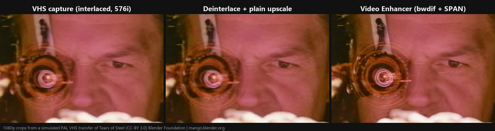
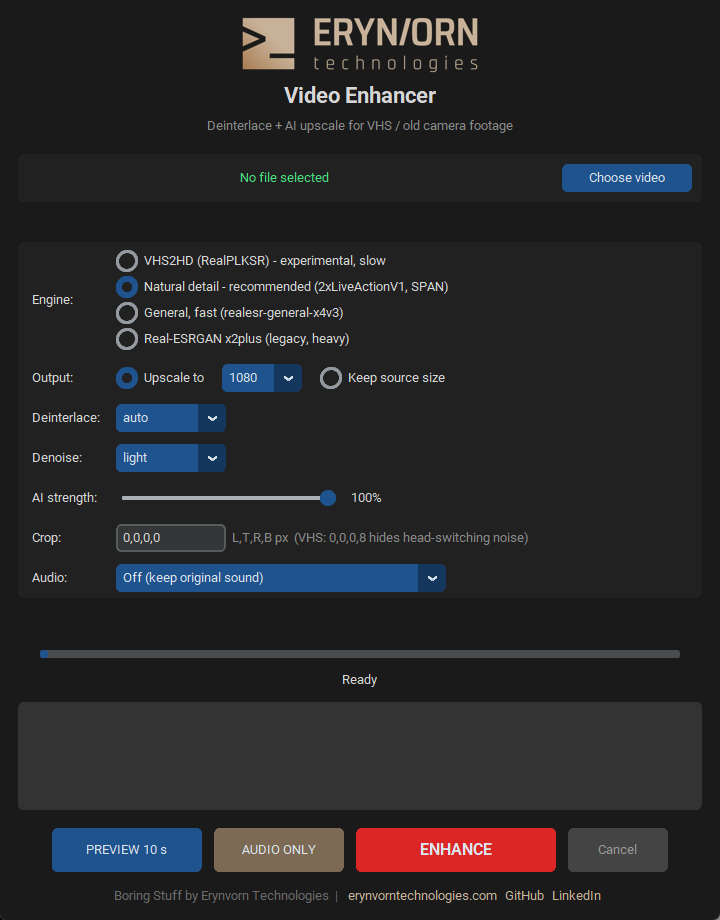

<p align="center">
  <a href="https://erynvorntechnologies.com"></a>
</p>

# 📼 Video Enhancer

<p>
  <a href="https://erynvorntechnologies.com">Website</a> ·
  <a href="https://github.com/ErynVornTechnologies">GitHub</a> ·
  <a href="https://www.linkedin.com/in/kamil-krzysztof-nagorski/">LinkedIn</a>
</p>

Turn old VHS, Hi8 and early digital-camera footage into clean 1080p you can
actually watch on a big TV. It deinterlaces properly, fixes the aspect ratio
and upscales with a lightweight AI model. Everything runs locally on your
own NVIDIA GPU, with no cloud, no uploads and no subscription.

Part of the **Boring Stuff** series: small, useful tools that do one dull job well.



## 🌟 Features

- **One click from tape capture to 1080p.** Pick a file, preview 10 seconds, press ENHANCE.
- **Proper deinterlacing.** Interlacing is detected automatically (`idet`)
  and removed with motion-adaptive `bwdif` at double rate, so 25i becomes
  50p and 29.97i becomes 59.94p for smooth TV motion.
- **Correct shape and colour.** Anamorphic PAL/NTSC pixels become square
  (4:3 → 1440x1080, 16:9 → 1920x1080), with the right BT.601 → BT.709
  colour conversion and tags.
- **Natural-looking AI upscale.** Uses a SPAN model trained on real video
  defects, so faces don't come out plastic.
- **Fast.** About 23 frames/s on an RTX 4070 SUPER for 576i → 1080p50, so a
  10-minute tape takes roughly 20 minutes.
- **Safe defaults.** Optional temporal denoise, crop for VHS head-switching
  noise, an AI-strength slider, and audio kept as-is.
- **Modern dark GUI** with live log, progress, ETA and cancel. There is also a full CLI.

## 🛠️ Requirements

- Windows 10/11
- NVIDIA GPU with a current driver (developed on an RTX 4070 SUPER 12 GB;
  SD footage needs only about 1 GB of VRAM per frame, and the app falls
  back to tiling if memory runs out)
- About 6 GB of disk space (PyTorch with CUDA is the bulk of it)
- Python 3.12 and FFmpeg (`INSTALL.bat` installs both via winget if missing)

## 🚀 Installation

```bat
git clone https://github.com/ErynVornTechnologies/Video-Enhancer.git
cd Video-Enhancer
INSTALL.bat
```

`INSTALL.bat` creates a private `.venv` inside the folder, installs CUDA
PyTorch, `spandrel` and the GUI packages, then downloads the model weights.
Your global Python is not modified.

## 🎮 How to use

Double-click **`run.bat`**.

<p align="center"></p>

1. **Choose video** (mp4, mkv, avi, mpg, vob, mov, m2ts and more).
2. Check the detected format line (resolution, SAR, fps, field order).
3. Click **PREVIEW 10 s**. A 10-second clip from the middle is rendered and opened.
4. Happy? Press **ENHANCE**. The result is saved next to the source as
   `<name>_1080p_<engine>.mp4`.

**Recommended settings for VHS:** engine `span`, output `1080`, deinterlace
`auto`, denoise `light` (use `medium` for noisy tapes), crop `0,0,0,8`.

### Command line

```bat
.venv\Scripts\python.exe enhancer.py -i tape.mpg
.venv\Scripts\python.exe enhancer.py -i tape.mpg --denoise medium --crop 0,0,0,8
.venv\Scripts\python.exe enhancer.py -i tape.mpg --mode keep
.venv\Scripts\python.exe enhancer.py -i tape.mpg --start 60 --frames 250
```

Other options: `--engine`, `--height 720|1080|1440|2160`, `--strength 0.5-1.0`,
`--deinterlace auto|on|frame|off`, `--encoder x264|nvenc`, `--crf`, `--batch`.

## 🧠 Engines

Measured end to end (720x576 → 1080p, including x264 encoding) on an RTX 4070 SUPER:

| Engine | Model | Speed | Character | Weights licence |
|---|---|---|---|---|
| `span` (default) | [2xLiveActionV1 SPAN](https://openmodeldb.info/models/2x-LiveActionV1-SPAN) by jcj83429 | ~23 f/s | Natural texture, keeps fidelity | CC-BY-NC-SA-4.0, **non-commercial** |
| `compact` | [realesr-general-x4v3](https://github.com/xinntao/Real-ESRGAN) | ~15 f/s | Smooth, a little plastic | BSD-3-Clause |
| `x2plus` | [RealESRGAN x2plus](https://github.com/xinntao/Real-ESRGAN) | ~4 f/s | Strong, waxy on faces | BSD-3-Clause |
| `vhs2hd` | [2xVHS2HD RealPLKSR](https://openmodeldb.info/models/2x-VHS2HD) by asterixcool | ~1.5 f/s | Experimental, softer than plain upscale in our tests | CC-BY-SA-4.0 |

> ⚖️ The code is MIT. The **model weights are not part of this repository**:
> `INSTALL.bat` downloads them from their authors, and each keeps its own
> licence. For commercial work, use `compact` or `x2plus`.

## 🔊 Audio restoration

Pick **Audio** in the GUI (or `--audio` on the command line):

| Mode | What it does | Speed (RTX 4070 SUPER) | Safe for music? |
|---|---|---|---|
| `off` (default) | Original sound, re-encoded to AAC only if MP4 can't hold it | – | yes |
| `clean` | Classic DSP, never changes voices: hard-clip repair (`adeclip`), clicks (`adeclick`), rumble, automatic 50/60 Hz hum notch (only when hum is detected), tape hiss (`afftdn`), gentle compression, EBU R128 loudness (-16 LUFS), limiter | ~20x real time | yes |
| `voice` | `clean` + [DeepFilterNet](https://github.com/Rikorose/DeepFilterNet) speech denoiser, limited to 18 dB of attenuation so background is reduced rather than deleted | ~4x real time, CPU only | partly |
| `voice-hq` | `clean` + [ClearerVoice](https://github.com/modelscope/ClearerVoice-Studio) MossFormer2_SE_48K, blended 85/15 with the classic result | ~5x real time on GPU, plus ~20 s model load | partly |

- Everything runs in 32-bit float with headroom. In testing, 16-bit
  processing of a tape that already peaked at -0.3 dB pushed the output into clipping.
- The restored track is trimmed and padded to exactly the video length, so
  previews and full runs stay frame-accurate.
- **AI voice modes treat music, singing and ambience as noise.** On birthday
  or concert footage, compare with `clean` using PREVIEW first.
- Analogue overload (tape saturation) can't be undone. `adeclip` only repairs
  digitally flat-topped peaks; levelling makes the rest less harsh.
- ClearerVoice lives in its own `.venv_audio`, because it pins `numpy<2`,
  librosa and opencv, which would break the video environment. `INSTALL.bat`
  asks before installing it (~4 GB).
- `cv_worker.py` refuses to run if the weights' pointer file is missing.
  clearvoice 0.1.2 + huggingface_hub 2.x can otherwise run silently on
  **random weights** (seen in testing: output 25 dB quieter, pure garbage).

Licences: DeepFilterNet MIT/Apache-2.0; ClearerVoice code and MossFormer2_SE_48K weights Apache-2.0.

### Audio only: fix the sound of a video you already enhanced

Upscaling takes hours and the picture is already done? Choose the **enhanced**
file, pick an Audio mode and press **AUDIO ONLY**:

1. The sound is taken from the **original recording** (lossless FLAC from the
   capture, not the AAC copy inside the enhanced file). It is found by name
   (`Tape.mkv` ↔ `Tape_1080p_span.mp4`); otherwise you pick it. Both must have
   the same length (±1 s), or it refuses.
2. The soundtrack is restored with the chosen mode. Audio **Off** puts the
   original sound under the picture untouched, converted only to AAC.
3. The picture is **stream-copied**: bit-identical, no re-encode. A 72 s tape
   took 11-25 s instead of ~2 min of upscaling.

```bat
.venv\Scripts\python.exe enhancer.py -i Tape_1080p_span.mp4 --audio-only --audio clean
.venv\Scripts\python.exe enhancer.py -i Tape_1080p_span.mp4 --audio-only --audio voice --audio-from D:\Tapes\Tape.mkv
```

Lip sync was verified by cross-correlation against the original track: **0 ms
offset in every mode**. `afftdn` adds a fixed 1200-sample delay at 48 kHz and
`alimiter` adds 5 ms; both are compensated.

## ⚙️ How it works

```
ffmpeg decode ─► idet / bwdif (x2 rate) ─► crop ─► hqdn3d ─► BT.601/709 → RGB
     ─► GPU: SR model (fp16, batched) ─► one antialiased resize to target (fixes SAR)
     ─► ffmpeg x264/NVENC with BT.709 tags + original or restored audio (audio.py)
```

- Frames are piped through memory, so no temporary image files ever touch the disk.
- Reader, GPU and writer run in separate threads, so the GPU never waits on pipes.
- Any OpenModelDB model can be added in `model.py` (`ENGINES`), because
  [spandrel](https://github.com/chaiNNer-org/spandrel) loads the architecture automatically.

## 🧪 Self-test

```bat
.venv\Scripts\python.exe test_enhancer.py
```

This checks that every engine loads and keeps brightness stable, then runs
a synthetic 576i clip with audio end to end and verifies 1440x1080 at 50 fps.

## 🚧 Limitations

- `bwdif` is very good, but QTGMC (VapourSynth) is still the gold standard for deinterlacing.
- Single-frame models can shimmer slightly on heavy tape noise. Denoise `light`/`medium` helps.
- Severe chroma bleed, tracking errors and dropouts are not repaired.
- Windows and NVIDIA only (the code itself is portable, only the `.bat` files are not).

## 📄 Licence

Code: MIT (see `LICENSE`). Model weights: see the table above.
Comparison image: *Tears of Steel* (CC-BY 3.0) Blender Foundation | mango.blender.org.

Erynvorn logo and name: © Erynvorn Technologies, not covered by the MIT licence.

---

<p align="center">
  <a href="https://erynvorntechnologies.com"></a><br>
  Built by <a href="https://erynvorntechnologies.com"><b>Erynvorn Technologies</b></a>: sovereign, on-premise AI.<br>
  More Boring Stuff on <a href="https://github.com/ErynVornTechnologies">GitHub</a>
  and <a href="https://www.linkedin.com/in/kamil-krzysztof-nagorski/">LinkedIn</a>.
</p>
